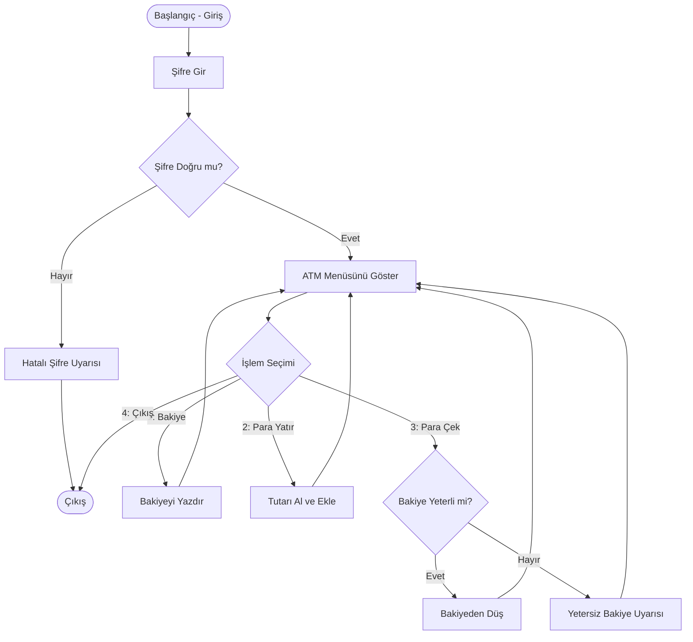

# BANKAMATİK
# Mini Bankamatik (ATM) Sistemi

Bu proje, Python temel veri yapıları, koşul ifadeleri, döngüler ve Nesne Tabanlı Programlama (`class`) kullanılarak geliştirilmiş konsol tabanlı bir Bankamatik uygulamasıdır.

## Sınıf ve Fonksiyon Yapısı
* **`Hesap` Sınıfı:** Hesap numarası ve bakiye bilgilerini tutar. `para_yatir()`, `para_cek()` ve `bakiye_goster()` metotları ile hesap işlemlerini gerçekleştirir.
* **`Kullanici` Sınıfı:** Müşteri adını, şifresini ve ilgili `Hesap` nesnesini tutar. `sifre_kontrol()` metodu ile güvenlik doğrulaması yapar.

## Akış Şeması (Flowchart)

